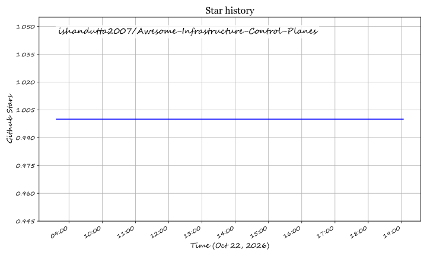

# 🚀 Awesome Infrastructure Control Planes 🎛️

**A curated index of production-ready SaaS platforms and open-source infrastructure control planes, declarative orchestration engines, and continuous reconciliation systems.**

  
  
  
  
  
  

  <b>Keywords:</b> Infrastructure as Code (IaC) • Cloud Control Planes • Continuous Reconciliation • GitOps • Terraform • OpenTofu • Crossplane • Pulumi • Drift Detection • Policy as Code

---

## 📖 Overview

This repository tracks notable **SaaS platforms** and **open-source projects** for **Infrastructure Control Planes**. These solutions deliver the orchestration fabric for modern cloud infrastructure—managing state persistence, evaluating policy-as-code, remediating configuration drift, and executing declarative rollouts via triggered pipelines (Terraform/OpenTofu) or continuous reconciliation control loops (Kubernetes/Crossplane).

---

## 📑 Table of Contents

- [📊 Sector Overview & Market Dynamics](#-sector-overview--market-dynamics)
- [☁️ SaaS / Hosted Control Planes](#️-saashosted-platforms)
- [🔓 Open-Source Control Planes & Engines](#-open-source-github-projects)
- [🤝 How to Contribute](#-how-to-contribute)
- [💖 Support](#-support)
- [📈 Star History](#-star-history)
- [⚠️ Disclaimer](#️-disclaimer)

---

## 📊 Sector Overview & Market Dynamics

The global Infrastructure as Code (IaC) and Cloud Systems Management market is estimated at **$1.5B to $7B+** (broad cloud systems management software reaching upwards of **$40B+**), compounding at an annual growth rate (CAGR) of **~20–24%**. Market dynamics reflect a **moderately fragmented yet bifurcated sector**: hyperscalers dominate native workloads with free proprietary tooling, while independent orchestration is anchored by category champions alongside emerging multi-IaC orchestration startups, preventing a single "winner-take-all" outcome.

---

## ☁️ SaaS/Hosted Platforms

| 🏢 Platform | 💰 Company Valuation / Revenue | 🏷️ Pricing (Starting Tier) | 🎁 Free Tier Limits | ⚙️ Key Highlights & Architecture |
| :--- | :--- | :--- | :--- | :--- |
| **[Microsoft (Azure Bicep)](https://learn.microsoft.com/en-us/azure/azure-resource-manager/bicep/)** | Market Cap: ~$3.1T+ / Revenue: ~$245B+ | **$0.00** (Included with Azure resource usage; no engine license fees) | **Free forever without operational limits** (Zero tool cost; standard Azure resource deployment quota limits apply) | Native domain-specific language compiling to ARM JSON; VS Code extension with IntelliSense and what-if preview. |
| **[Amazon AWS (CloudFormation)](https://aws.amazon.com/cloudformation/)** | Market Cap: ~$2.0T+ / Revenue: ~$100B+ (AWS) | **$0.00** for standard `AWS::*` resources; **$0.0009** per third-party/hook operation | **Free forever for all standard AWS resources**; 1,000 extension handler operations/month free for third-party extensions | Native JSON/YAML template engine, change sets, drift detection, and StackSets across multi-account/multi-region setups. |
| **[HashiCorp (Terraform Cloud / HCP Terraform)](https://www.hashicorp.com/products/terraform)** | Valuation: $6.4B (Acquired by IBM) / Revenue: ~$646M | **$0.10 / resource / month** (Essentials tier; Standard tier starts at $0.47 / resource / month) | **Up to 500 managed resources free forever**, 1 concurrent run, unlimited users, VCS integrations | Official managed platform for Terraform/OpenTofu; provides remote state, Sentinel/OPA policies, and team collaboration. |
| **[Pulumi (Pulumi Cloud)](https://www.pulumi.com/cloud/)** | Valuation: ~$1.5B (Series D) / Revenue: ~$15M–$20M+ ARR | **$40 / month** (Essentials tier, includes up to 500 managed resources and unlimited users) | **Free forever for 1 user**, unlimited resources and stacks, includes up to 500 deployment workflow minutes/month | Multi-language IaC engine (TypeScript, Python, Go, C#); managed state, Pulumi ESC secrets, drift detection, and Pulumi Neo AI. |
| **[Morpheus Data (HPE Morpheus Software)](https://www.morpheusdata.com/)** | Valuation: ~$83M+ prior to acquisition (Acquired by HPE) / Revenue: Enterprise multi-million ARR | Custom / **Per-socket software pricing** (Starting via HPE GreenLake private cloud plans) | **60-day free trial** (up to 6 sockets with VM Essentials evaluation) or **365-day Community Edition** (up to 3 sockets for non-production lab use) | Enterprise CMP for hybrid cloud & bare metal orchestration; self-service catalog, governance, and VMware-to-KVM migration. |
| **[env0](https://www.env0.com/)** | Valuation: ~$72M (Series A) / Revenue: ~$5M+ ARR | Custom annual contracts (Paid tiers: *Cloud Navigator* & *Cloud Pilot* with unlimited runs & concurrency) | **Free forever for up to 250 runs/month**, up to 30 active environments, unlimited users and agents | Multi-IaC platform supporting Terraform, OpenTofu, Terragrunt, and Pulumi; native FinOps cost tracking and role-based policies. |
| **[Spacelift](https://spacelift.io/)** | Funding: ~$73M raised (Series C) / Revenue: ~$5M–$10M ARR | **~$20,000 / year** (Starter+ entry paid tier with private workers & annual commitment) | **Free forever for up to 2 users**, 1 public worker (1 concurrent run), unlimited stacks & VCS integrations; 14-day full-feature trial for paid tier | Concurrency-driven multi-IaC orchestration supporting Terraform, OpenTofu, Pulumi, CloudFormation, and Kubernetes; OPA policies. |
| **[Scalr](https://scalr.com/)** | Funding: ~$7.35M raised / Revenue: ~$3M–$5M ARR | **$0.99 / run** (Pay-as-you-go Business plan for runs beyond monthly free quota) | **Free forever for up to 50 runs/month**, includes 5 concurrent runs, unlimited users, environments, OPA policies, and drift detection | Drop-in Terraform Cloud replacement; run-based billing, PR comment controls (`/scalr plan`, `/scalr apply`), and full OPA governance. |

---

## 🔓 Open-Source GitHub Projects

The open-source landscape offers powerful self-hosted alternatives, custom reconciliation loops, and developer-first CI/CD control planes. Repositories below are ordered in **descending Stars_Count**.

1. ### 🌐 [OpenTofu](https://github.com/opentofu/opentofu) 
   - **The MPL-2.0 open-source Terraform fork**, community-governed under the Linux Foundation.
   - Drop-in compatibility with HCL syntax, providers, and modules.
   - Enhances state/plan encryption, skip-resource controls during plan/apply, provider iteration (`for_each`), and early variable evaluation.

2. ### 💻 [Pulumi](https://github.com/pulumi/pulumi) 
   - **Multi-language IaC engine** enabling developers to define cloud infrastructure using TypeScript, Python, Go, C#, Java, and YAML.
   - Supports self-managed DIY state storage backends (S3, GCS, Azure Blob, local) without SaaS lock-in.
   - Features ephemeral test stacks, policy-as-code (CrossGuard), and high-fidelity modular software abstractions.

3. ### ☸️ [Crossplane](https://github.com/crossplane/crossplane) 
   - **Kubernetes-native declarative control plane** (CNCF Graduated project).
   - Extends the Kubernetes API with Custom Resource Definitions (CRDs) for cloud resources (AWS, Azure, GCP) with active, continuous reconciliation loops that remediate drift automatically.
   - Allows platform teams to author composable Custom APIs (XRDs) for internal self-service developer platforms.

4. ### 📦 [Terragrunt](https://github.com/gruntwork-io/terragrunt) 
   - **Flexible orchestrator and thin wrapper for Terraform/OpenTofu** that keeps configurations DRY (Don't Repeat Yourself).
   - Manages remote state configuration centrally, enforces explicit dependency graphs across multiple modules, and runs concurrent multi-stack operations.

5. ### 🤖 [Atlantis](https://github.com/runatlantis/atlantis) 
   - **Self-hosted GitOps pull request automation for Terraform and OpenTofu**.
   - Executes `terraform plan` on pull requests, outputs interactive diffs directly into PR comments, and applies configurations automatically upon merge or approval.

6. ### ⛏️ [Digger](https://github.com/diggerhq/digger) 
   - **Open-source CI/CD orchestrator for Terraform and OpenTofu** that runs directly within existing CI pipelines (GitHub Actions, GitLab CI, Bitbucket).
   - Eliminates need for duplicate compute infrastructure while providing concurrency locking, drift checks, and PR automation.

7. ### 🔀 [Plural](https://github.com/pluralsh/plural) 
   - **Unified GitOps continuous delivery & infrastructure control plane** designed for Kubernetes clusters and multi-cloud applications.
   - Provides automated dependency management, fleet-wide upgrades, and a unified management console across hybrid topologies.

8. ### 👥 [Terrateam](https://github.com/terrateamio/terrateam) 
   - **Open-source GitOps orchestration platform** built specifically for GitHub Actions with deep Terraform, OpenTofu, and Terragrunt support.
   - Features directory-based locking, automated plan reviews, and customizable RBAC workflows.

9. ### 🔌 [Google Cloud Config Connector](https://github.com/GoogleCloudPlatform/k8s-config-connector) 
   - **Kubernetes addon for managing GCP resources** declaratively via CRDs.
   - Forms the underlying foundation for Google Cloud Config Controller, continuously reconciling Google Cloud resources through Kubernetes control loops.

10. ### 🛠️ [AWS CloudFormation CLI](https://github.com/aws-cloudformation/cloudformation-cli) 
    - **Open-source toolset and SDK** for authoring and maintaining custom CloudFormation resource providers, private registry types, and guardrail hooks.

---

## 🤝 How to Contribute

Contributions are warmly welcome! Help expand this ecosystem tracker:

1. 🍴 Fork this repository.
2. 📝 Add or update an entry in `README.md` following the existing format.
3. 🔍 Ensure links are active and descriptions are factual and objective.
4. 🚀 Submit a Pull Request with a clear description of your additions.

---

## 💖 Support

If you find this repository helpful for evaluating infrastructure control planes and IaC orchestration engines:

- ⭐ **Star this repository** to help others discover it!
- 🍴 **Fork and share** it with your DevOps, SRE, and platform engineering teams.
- ☕ **Support the maintainer**: Buy a coffee or sponsor ongoing maintenance on the **[GitHub Sponsors Dashboard](https://github.com/sponsors/ishandutta2007)**!

---

##  Star History

---

## ⚠️ Disclaimer

- This is an independent **community-curated** list — not an endorsement of any single vendor.
- **Execution model matters more than tool name**: Plan/apply workflows (Terraform/OpenTofu/Pulumi) operate on scheduled/triggered gates, whereas continuous reconciliation engines (Crossplane/Config Connector) reconcile drift constantly without a manual `plan` approval.
- **Pricing models vary significantly**: Spacelift focuses on concurrency; Terraform Cloud charges by resources under management; Scalr utilizes run-based pricing; env0 provides generous free-tier quotas. Model your organization's resource counts and run frequency before selecting a platform.

## ⭐ Star History

<a href="https://star-history.com/#ishandutta2007/Awesome-Infrastructure-Control-Planes&Timeline" align="center">
  <picture>
    <source media="(prefers-color-scheme: dark)" srcset="assets/ishandutta2007_Awesome-Infrastructure-Control-Planes_growth.svg">
    
  </picture>
</a>
